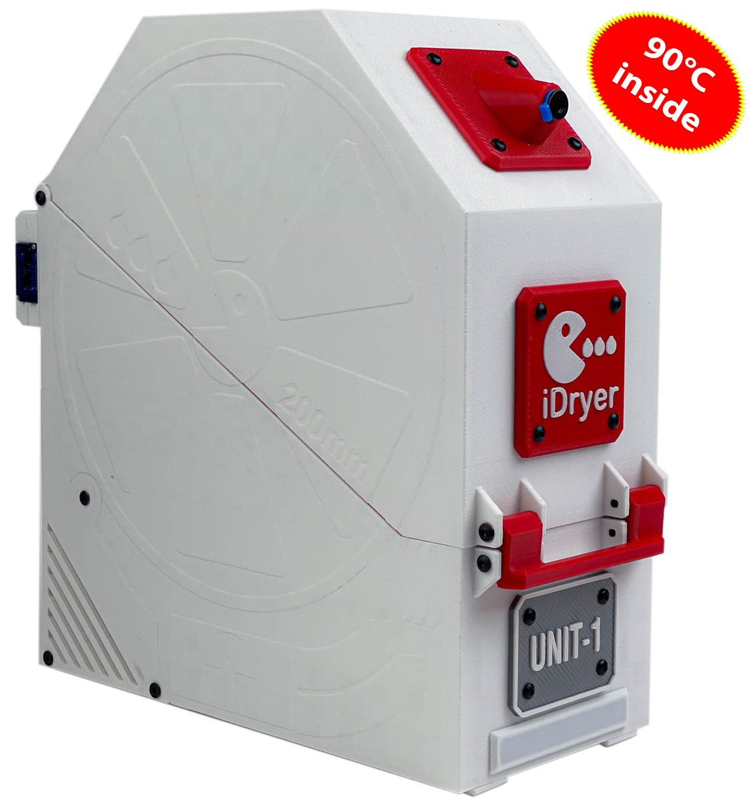
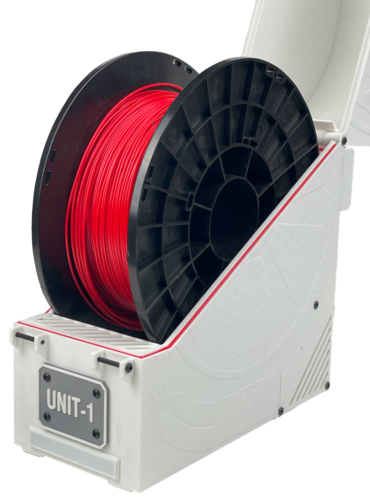
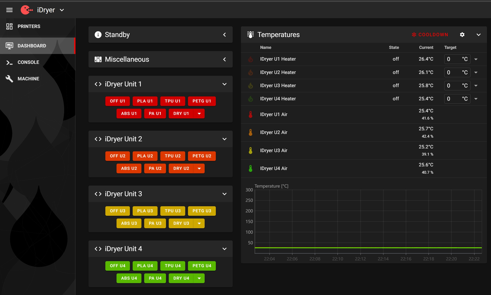
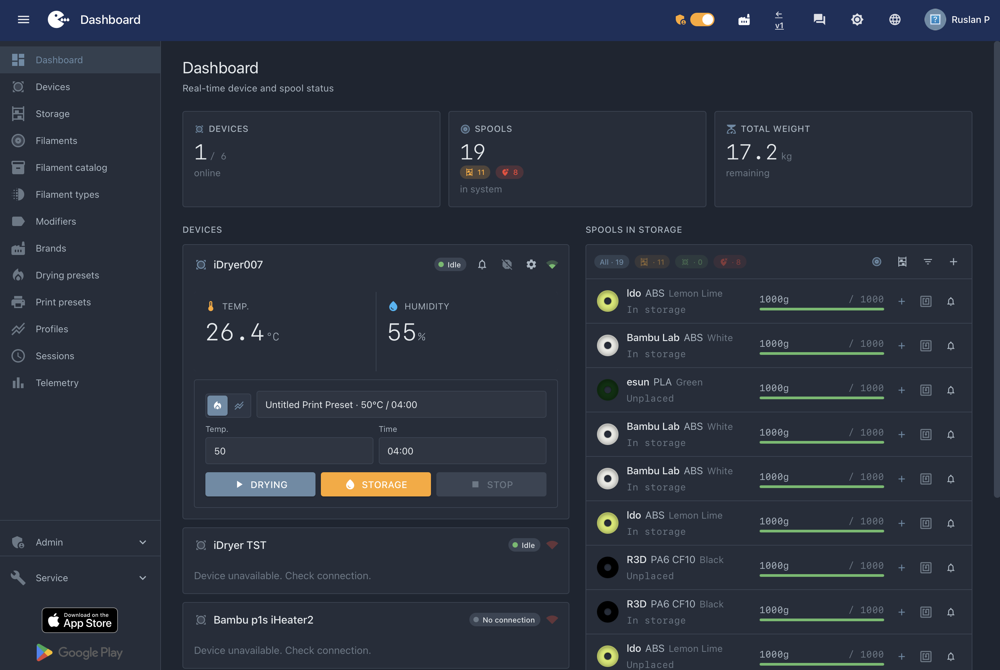
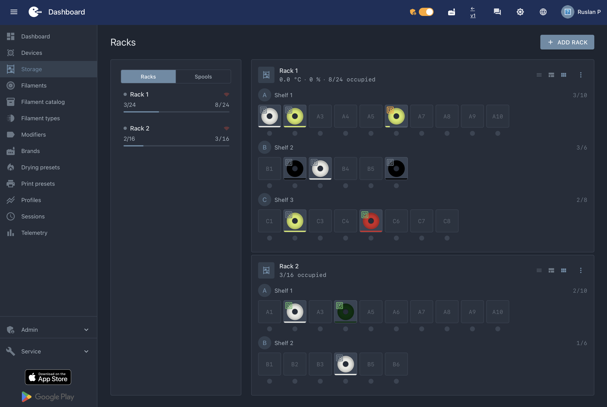
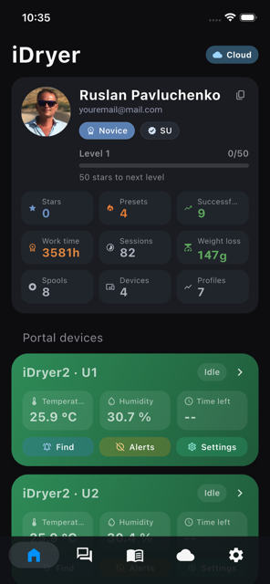
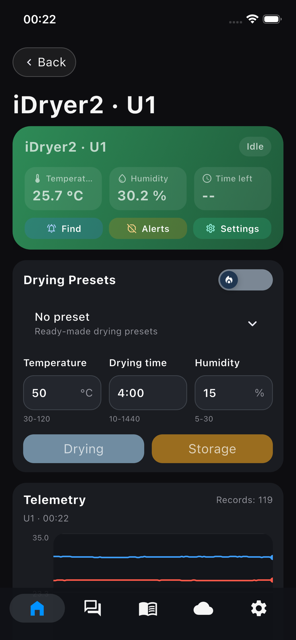
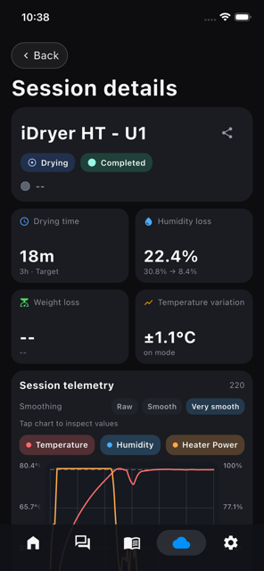
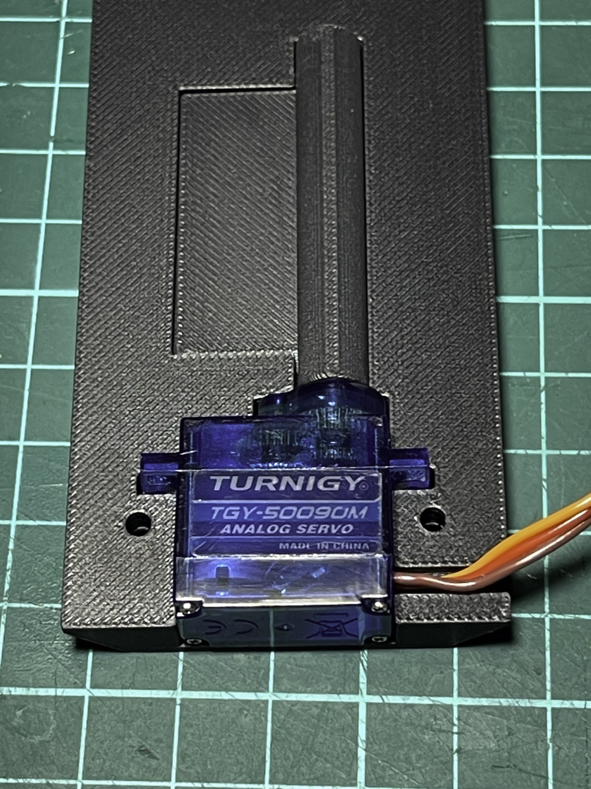
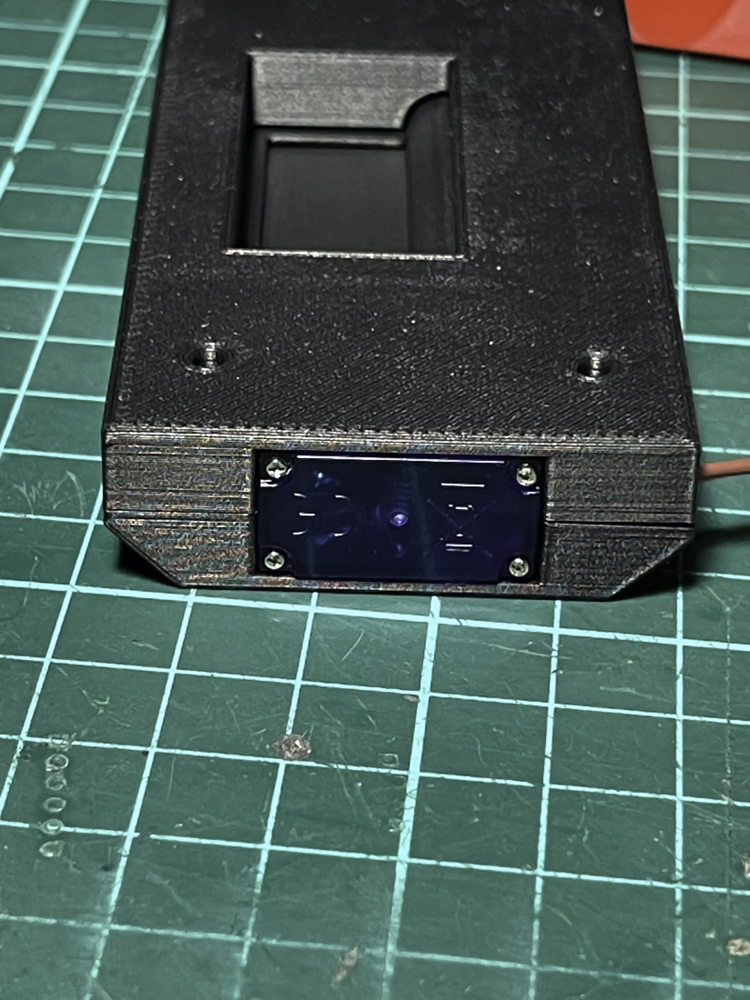

<div align="center">


# iDryer Unit

**Модульная сушилка филамента, которую вы печатаете и собираете сами. До четырёх камер, до 110 °C.**

[](https://docs.idryer.org/projects/idryer/unit/) [](https://t.me/iDryer) [](https://discord.gg/jGce5eeHHz) [](LICENSE)



</div>

---
## Что это

Сушилка филамента, собранная из стандартных комплектующих в печатном корпусе. Одна камера или четыре, одна катушка в камере или две.

Всё, из чего она состоит, можно купить в обычном магазине и заменить, когда понадобится: вентилятор, PTC-нагреватель, датчик температуры и влажности, сервопривод, термопредохранитель. Фирменных запчастей здесь нет.

<div align="center">



</div>

## Какую задачу решает

Инженерные филаменты набирают влагу из воздуха, и напечатанная из сырого материала деталь получается хуже, чем должна: пузыри, слабые слои, непредсказуемая усадка. Бытовая сушилка греет, но не даёт ни контроля, ни повторяемости — и работает с одной катушкой.

iDryer Unit сушит по заданной программе, показывает, что происходит внутри, и ведёт до четырёх камер одновременно. В каждой свой материал и свой режим.

## Для кого

Проект для тех, кому нужна не коробка с подогревом, а инструмент, и кто готов собрать его своими руками.

Готовые сушилки закрыты: сломался нагреватель — ищите фирменную запчасть, не устраивает логика — терпите. Здесь наоборот: схемы, прошивка и документация открыты, корпус печатается на любом принтере, а любой узел меняется на аналог из большинства маркетплейсов.

## Две прошивки на выбор

Сценарий выбирается после сборки — от него зависит и прошивка, и способ управления.

### Klipper

<div align="center">



</div>

Контроллер подключается к хосту принтера и работает как `[mcu]` или `[second_mcu]`. Управление — прямо из Fluidd или Mainsail, температура и влажность на том же экране, что и печать. Доступны макросы G-кода, уведомления в Telegram-бот и адресная лента для индикации режимов.

Подходит, если Klipper у вас уже работает и хочется всё в одном интерфейсе.

→ [Установка прошивки Klipper](https://docs.idryer.org/projects/idryer/unit/controller/firmware/)

### Standalone

Контроллер работает сам по себе, со своей прошивкой. Управление — через [портал](https://portal.idryer.org/) и мобильное приложение, локально — через экран. Здесь же появляются весы, RFID и режим профилей.

Подходит, если сушилка стоит отдельно от принтера или нужен удалённый контроль.

→ [iDryer Controller V2](https://github.com/pavluchenkor/iDryerControllerV2)

## Портал и приложение

<div align="center">

 

</div>

<div align="center">

  

</div>

В Standalone-режиме каждая сушка записывается: сколько шла, на сколько упала влажность, сколько ушло воды, насколько ровно держалась температура.

- [iDryer в App Store](https://apps.apple.com/app/idryer/id6760609044)
- [iDryer в Google Play](https://play.google.com/store/apps/details?id=org.idryer.mobile)

## Как устроена система

Один блок **MCU** управляет всем. К нему через RJ45 подключаются до трёх блоков **EXT** — без собственного микроконтроллера.

```
              ┌— RJ45 — [EXT U2]
[MCU] ————————┼— RJ45 — [EXT U3]
              └— RJ45 — [EXT U4]
```

Каждый блок — независимая камера со своим датчиком, нагревателем, вентилятором и заслонкой.

## Управление влажностью

<div align="center">

 

</div>

В каждой камере стоит управляемая заслонка на сервоприводе. Она открывается, чтобы выпустить насыщенный влагой воздух, и закрывается, чтобы удержать тепло. Датчик непрерывно следит за температурой и влажностью внутри, и прошивка подстраивает работу заслонки и нагревателя под то, что реально происходит в камере.

## Характеристики

| Параметр | Значение |
|---|---|
| Температура сушки | до 90 °C, до 110 °C с теплостойким корпусом |
| Режимы | сушка, хранение, профили |
| Количество камер | 1–4: MCU и до трёх EXT |
| Подключение модулей | патчкорды RJ45 |
| Катушки | 1 или 2 на камеру, до 85 мм шириной и 200 мм в диаметре |
| Корпус | печатный, ABS / ABS-CF / PC / HTPLA |
| Нагреватель | PTC, полная электрическая изоляция |
| Датчик | SHT3X или любой, поддерживаемый прошивкой |
| Термопредохранитель | KSD9700, 130 °C |
| Защита по току | предохранитель |

## Безопасность

Устройство работает от сети 110–230 В и греет часами, поэтому защита заложена и в железо, и в прошивку.

**KSD9700** физически размыкает цепь нагревателя при перегреве — независимо от того, что думает прошивка. **Предохранитель** отрабатывает аварийные токи. **PTC-нагреватель** устроен так, что его корпус не находится под напряжением. Прошивка контролирует температуру и наличие датчиков и снимает нагрев при ошибке.

> **Внутри сетевое напряжение.** Перед любыми работами с электрикой отключайте питание. Это электрический нагревательный прибор — не оставляйте его включённым без присмотра.

→ [Раздел «Безопасность»](https://docs.idryer.org/projects/idryer/unit/unit/safety/)

## Что понадобится (BOM)

На камеру: PTC-нагреватель 100 Вт, турбинный вентилятор, сервопривод заслонки, датчик SHT31, термопредохранитель KSD9700, OLED-экран с энкодером, светодиодная лента, крепёж и провода.

Полный список с фотографиями, количествами и ссылками на заказ — в [комплектации](https://docs.idryer.org/projects/idryer/unit/unit/bom/).

Модели для печати — в [разделе CAD](https://docs.idryer.org/projects/idryer/unit/unit/cad/).

### Контроллер

Готовые платы: **MCU** — основная, с микроконтроллером и тремя разъёмами RJ45, и **EXT** — по одной на каждую дополнительную камеру, без своего микроконтроллера.

Собрать контроллер самому тоже можно. В документации есть распиновка RP2040 и разъёмов, проект прототипа на макетной плате и вариант со старой платой принтера и твердотельными реле.

→ [Платы MCU и EXT](https://docs.idryer.org/projects/idryer/unit/controller/board/) · [Самостоятельная сборка](https://docs.idryer.org/projects/idryer/unit/controller/diy/)

## Сложность и стоимость

| | |
|---|---|
| Пайка | требуется |
| 3D-печать | корпус и механика, ABS или другой теплостойкий филамент |
| **Опасное напряжение** | **да, 110–230 В** |
| Навыки | сборка по инструкции, работа с сетевым напряжением |
| Время | вечер на сборку одной камеры |

## Быстрый старт

1. **Выберите сценарий** — Klipper или Standalone. От него зависит прошивка.
2. **Закажите комплектующие** по [списку](https://docs.idryer.org/projects/idryer/unit/unit/bom/).
3. **Напечатайте корпус** — [модели](https://docs.idryer.org/projects/idryer/unit/unit/cad/).
4. **Соберите** по [инструкции](https://docs.idryer.org/projects/idryer/unit/unit/assembly/).
5. **Прошейте и настройте** — [Klipper](https://docs.idryer.org/projects/idryer/unit/controller/firmware/) или Standalone через [install.idryer.org](https://install.idryer.org/).

## Место в экосистеме

| Слой | Что делает | Репозиторий |
|---|---|---|
| Сушилка | Корпус, механика, схемы — **этот репозиторий** | iDryer-Unit |
| Контроллер | Standalone-прошивка | [iDryerControllerV2](https://github.com/pavluchenkor/iDryerControllerV2) |
| Связь | Wi-Fi, портал, приложение | [iDryer Link](https://github.com/pavluchenkor/iDryer-Link) |
| Связь с экраном | То же плюс сенсорный дисплей | [iDryer Touch](https://github.com/pavluchenkor/idryer-touch) |
| Облако | Портал, приложение, интеграции | [portal.idryer.org](https://portal.idryer.org/) |

## Статус

Проект в релизе. Корпуса на одну и две катушки, обе прошивки в работе: Klipper и Standalone.

## Что лежит в репозитории

| Путь | Что это |
|---|---|
| `CAD/` | Модели корпуса и механики для печати |
| `iDryer_mcu/` | Прошивка основного блока |
| `iDryer_second_mcu/` | Прошивка для работы вторым MCU в Klipper |
| `User-mods/` | Доработки от сообщества |

## Лицензия

Код, CAD-модели, чертежи и механика — [GNU GPL v3.0 или новее](LICENSE), [NOTICE](NOTICE).

Печатные платы и схемы не опубликованы.

Имя iDryer лицензией не покрывается — [TRADEMARKS.md](https://github.com/pavluchenkor/idryer-core/blob/main/TRADEMARKS.md).

## Помощь

- [Telegram](https://t.me/iDryer)
- [Discord](https://discord.gg/jGce5eeHHz)
- [Документация](https://docs.idryer.org/projects/idryer/unit/)

Инструкции и разборы на канале: [YouTube](https://www.youtube.com/@iDryerProject) · [Rutube](https://rutube.ru/channel/34401569/)

## Участие

Собрали свою версию, доработали корпус, нашли ошибку в инструкции — заводите issue или присылайте pull request. Доработки сообщества лежат в `User-mods/`.

## Дальше

[Посмотрите комплектацию](https://docs.idryer.org/projects/idryer/unit/unit/bom/): по ней видно, во что обойдётся сборка.
